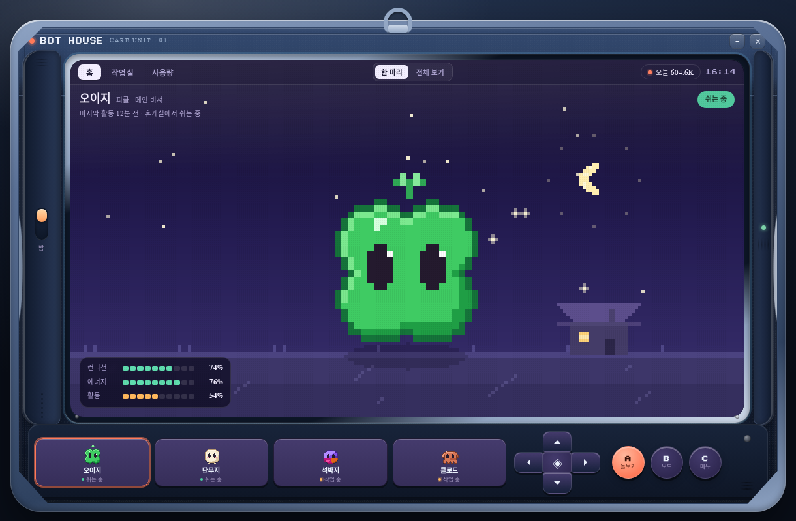
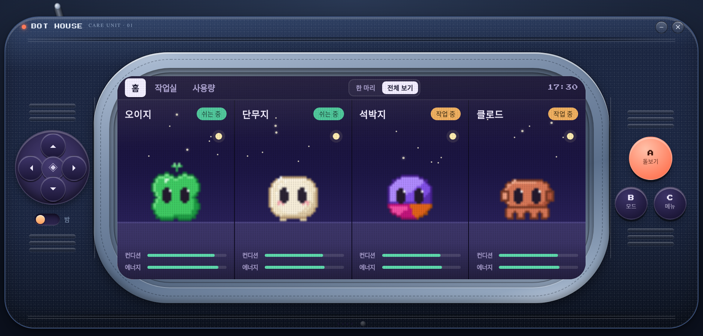
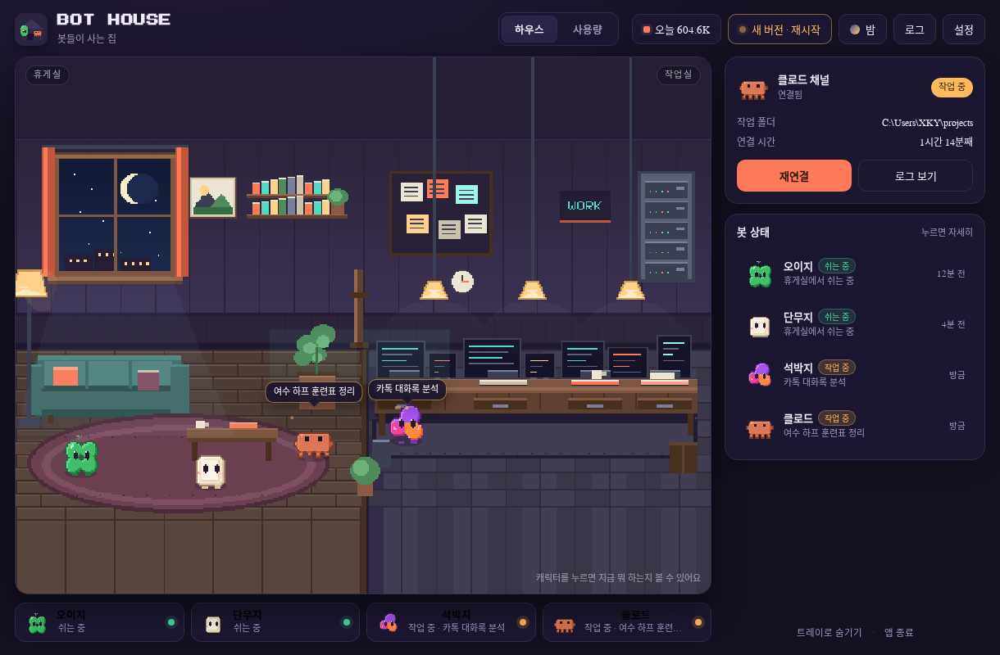

# Bot House

봇들이 사는 집. Windows용 데스크톱 앱으로, 앱을 켜면 4마리 봇을 돌보는 다마고치 액정이 먼저 열리고, Claude Code 텔레그램 채널이 자동으로 연결됩니다. 창 전체가 손바닥만 한 디지바이스형 기기로 그려집니다 — 580×450 창에 안테나, 상·하단 홈 요철, 왼쪽 그립의 큼직한 D-패드, 오른쪽 그립의 A·B·C 버튼, 가운데는 둥근 링 베젤에 들어간 정사각 액정. 아래쪽 봇 선택 바는 없앴고, 봇 전환은 D-패드 ←/→ 또는 C 메뉴로 합니다.



B 버튼을 누르면 **"치킹!"** 하고 양옆 그립이 밀려나며 창이 940×450으로 가로로 펼쳐지고, 와이드 액정에 4마리가 1×4로 나란히 섭니다. 다시 누르면 접힙니다.



캐릭터는 `docs/characters/`의 원본을 기준으로, v1.0.1의 아담한 SD 비율(몸통 19~22px, 위쪽 여백)로 다시 그립니다 — 오이지(풀색 네잎 쿠션 + 새싹), 단무지(크림 모찌 쿠션 + 볼터치), 석박지(보라·핑크·오렌지가 동글게 맞물린 3색 몸), 클로드(테라코타색 Clawd). 공통 규칙은 입·코 없이 세로로 긴 검은 눈 두 개와 오른쪽 위 흰 반짝 하이라이트입니다.


## 기기 조작

| 조작 | 하는 일 |
| --- | --- |
| 상단 탭 | 홈(케어) · 작업실 · 사용량 화면 전환 |
| D-패드 ↑ · ↓ | 화면 전환 |
| D-패드 ← · → | 봇 이동 (돌보기 시트가 열려 있으면 항목 선택) |
| A | 돌보기 시트 열기 · 항목 실행 |
| B | 한 마리 ↔ 전체 보기 (창이 가로로 펼쳐지며 "치킹!") |
| C | 기기 메뉴 (클로드 채널·봇 상태·로그·설정·업데이트) |
| 좌측 그립 슬라이드 | 낮 / 밤 전환 |
| 상단 − · × | 트레이로 숨기기 · 앱 종료 |

전체 보기에서 봇 한 마리를 누르면 그 봇의 한 마리 화면으로 돌아오면서 창이 다시 580×450으로 접힙니다. 변신할 때는 합성한 효과음(`renderer/sfx.js`, "치킹!"·"철컥")이 함께 납니다.

## 무엇을 하나요

- **다마고치 케어** — 홈 화면은 봇 4마리를 돌보는 다마고치 액정입니다. 정사각 액정에 한 마리씩 크게 보거나(B로 펼치면 4마리 한 줄), 컨디션·에너지·활동 게이지를 아래 미니 게이지로 확인합니다. 쓰다듬기·간식·응원하기·재우기를 누르면 캐릭터가 점프하고 하트·반짝이·간식·이불로 반응하며, 작업 중인 봇은 키보드를 두드리고 오프라인이면 이불을 덮고 잽니다. 낮/밤 설정에 따라 액정 배경(해·구름 / 달·별)이 바뀝니다.
- **픽셀 하우스** — 왼쪽은 휴게실(소파·러그·창문), 오른쪽은 작업실(책상·모니터·서버랙). 노는 봇은 휴게실을 거닐고, 일하는 봇은 자기 책상으로 걸어가 앉습니다. 책상 위 말풍선으로 누가 무엇을 하는지 바로 보입니다.
- **Claude 채널 자동 연결** — 앱을 켜면 `claude --channels plugin:telegram@claude-plugins-official`을 **작업 표시줄에 내려간 실제 터미널 창**으로 실행합니다. Claude Code는 진짜 콘솔(TTY)이 있어야 채널이 붙어서, v1.0.5부터는 보이지 않는 파이프 대신 최소화된 콘솔 창을 씁니다. 창을 열면 실시간 출력과 오류를 그대로 볼 수 있고, 앱의 로그 탭에는 실행·연결·끊김 기록이 남습니다. 채널이 끊기면 자동으로 다시 띄우고(시작 직후 실패는 창에서 오류를 확인하도록 재시도하지 않음), 기기 메뉴나 트레이에서 멈추면 그 창도 함께 닫힙니다.
- **봇 상태** — 클로드는 실행 중인 프로세스와 `~/.claude/projects` 세션 기록으로 실제 작업 여부를 감지합니다. 오이지·단무지·석박지는 상태 API로 신호를 받습니다.
- **토큰 사용량 대시보드** — 이 PC에 있는 AI 도구의 세션 기록에서 오늘/이번 주 토큰을 직접 합산합니다(Claude Code, Codex CLI 등). 원격 봇은 API로 받은 값만 표시하고, 없으면 '신호 대기'로 정직하게 표시합니다.
- **트레이 상주** — 창을 닫아도 트레이에서 계속 돌아갑니다. 트레이 메뉴: 열기 / Claude 재연결 / 채널 멈추기 / 종료.
- **자동 업데이트** — 앱을 켜고 15초 뒤, 그다음 6시간마다 새 버전을 확인합니다. 새 버전은 자동으로 내려받고, 다운로드가 끝나면 상단에 `새 버전 · 재시작` 버튼과 안내 창이 뜹니다. 누르면 바로 재시작해 적용하고, 그냥 두면 앱을 종료할 때 자동으로 설치됩니다.



## 설치

1. Releases에서 `BotHouse-1.0.0-x64-setup.exe`(설치본) 또는 `BotHouse-1.0.0-portable.exe`(설치 없이 실행)를 받습니다.
2. 실행하면 창이 열리고, Claude CLI가 있으면 채널 연결을 시도합니다.
3. Claude CLI가 없다면 설정에서 실행 경로를 지정할 수 있습니다.

## 설정 항목

| 항목 | 설명 |
| --- | --- |
| Claude를 실행할 폴더 | 채널이 실행될 작업 폴더. 비우면 사용자 폴더 |
| 앱을 켜면 자동 연결 | 실행 시 채널 자동 시작 |
| 끊기면 자동 재연결 | 종료 감지 시 지수 백오프로 재시도 |
| 창을 닫으면 트레이로 숨기기 | X를 눌러도 종료하지 않음 |
| 윈도우 시작할 때 같이 실행 | 로그인 시 자동 실행 |
| 화면 테마 | 밤 / 낮 |
| Claude 실행 명령 · 채널 인자 | 자동 탐색 실패 시 직접 지정 |

## 봇 상태 API

텔레그램 `getUpdates`는 쓰지 않습니다(피클 서버의 오프셋과 충돌). 대신 로컬 API로 상태와 사용량을 받습니다.

```bash
# 전체 상태
curl http://127.0.0.1:47820/status

# 봇 상태 알리기 (오이지가 작업을 시작할 때)
curl -X POST http://127.0.0.1:47820/status \
  -H "Content-Type: application/json" \
  -d '{"bot":"oiji","state":"working","note":"가계부 정리"}'

# 토큰 사용량까지 함께
curl -X POST http://127.0.0.1:47820/status \
  -H "Content-Type: application/json" \
  -d '{"bot":"takuan","state":"idle","usage":{"todayTokens":182000,"weekTokens":940000}}'
```

`state`는 `idle` / `working` / `offline` 중 하나입니다. 설정의 '상태 주소'에 JSON URL을 넣으면 주기적으로 읽어 옵니다.

## 토큰 사용량은 어디서 오나요

- **Claude Code**: `~/.claude/projects/**/*.jsonl`의 assistant 메시지 `usage` 필드(input/output/cache)를 날짜별로 합산.
- **쿼터**: `~/.claude/.credentials.json`의 OAuth 토큰으로 Claude 사용량 조회를 시도하고, 안 되면 로컬 합산만 표시합니다.
- **Codex CLI**: `~/.codex/sessions/**/*.jsonl`의 `token_count` 이벤트에서 세션별 누적 토큰을 읽음.
- **Gemini CLI**: `~/.gemini`에 기록이 있으면 표시, 형식을 아직 읽지 못하면 그렇다고 표시.
- **원격 봇**: 이 PC에서 셀 수 없으므로 상태 API로 받은 값만 표시. 없으면 '신호 대기'.

숫자는 지어내지 않습니다. 읽지 못하면 읽지 못했다고 표시합니다.

## 개발

```bash
npm install
npm start          # 전자 실행
npm run dist       # Windows 설치본 + 포터블 빌드 (dist/)
```

픽셀 아트는 `tools/gen_art.py`(배경·스프라이트)와 `tools/sprites.py`(캐릭터)로 생성합니다. 결과물은 `assets/`에 커밋되어 있습니다. 캐릭터는 `sprites.py`의 `build()`가 11프레임(숨쉬기 2 · 걷기 4 · 작업 4 · 잠 1)으로 그리고, 클로드(Clawd)는 `mask_clawd()`가 통통한 가로 몸통 + 짧은 팔 두 개 + 다리 네 개로 만듭니다.

UI만 빠르게 확인하려면 `renderer/index.html`을 브라우저로 열면 됩니다(가짜 상태로 동작하는 미리보기 모드). 미리보기에서는 기기 창이 580×450으로 떠 있고, B를 누르면 940×450으로 펼쳐집니다. `?demo=update`를 붙이면 업데이트 알림 모양을 볼 수 있습니다.

## 릴리스와 자동 업데이트

업데이트 파일(`electron-updater`)은 GitHub Releases에서 `latest.yml`을 읽습니다. 그래서 릴리스에는 아래 세 가지가 함께 올라가야 합니다.

- `BotHouse-<버전>-x64-setup.exe`
- `latest.yml`
- `BotHouse-<버전>-x64-setup.exe.blockmap` (없으면 전체 파일을 다시 받습니다)

`package.json`의 `build.publish`가 `xkysius-git/Bot-House`(GitHub)로 지정되어 있어, `npm run dist -- --publish always`로 빌드하면 셋 다 자동으로 올라갑니다. `--publish never`로 빌드할 때는 `dist/`에 세 파일이 만들어지므로 직접 릴리스에 붙여야 합니다.

빌드가 끝나면 `tools/after_build.js`(`afterAllArtifactBuild` 훅)가 `dist/latest.yml`을 다시 만들고, 그 내용과 exe별 sha512를 빌드 로그에 `-----BOTHOUSE_LATEST_YML_BEGIN-----` 사이에 찍습니다. latest.yml이 릴리스에서 빠졌을 때는 로그에서 그대로 꺼내 올리면 됩니다.

> 주의: `.github/workflows/build.yml`의 릴리스 업로드 단계는 지금 `dist/*.exe`만 올립니다. 자동 업데이트가 계속 동작하려면 업로드 대상을 `dist/*.exe dist/latest.yml dist/*.blockmap`으로 바꾸고, 태그를 `v1.0.0` 고정 대신 `package.json` 버전에서 만들도록 바꾸는 게 좋습니다.

## 참고

- 이 앱은 사용자의 PC에서만 동작합니다. 원격 봇의 상태/사용량은 각 봇이 API로 알려줘야 보입니다.
- Claude CLI 로그인은 미리 되어 있어야 합니다(`claude` 실행 후 `/login`).
